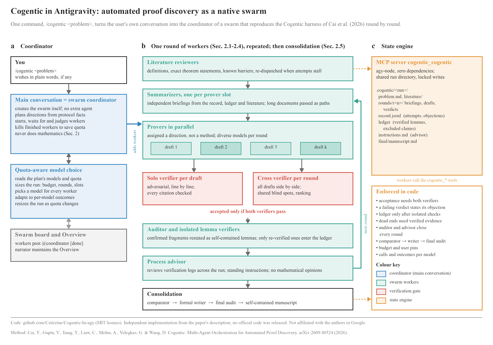

# Cogentic-In-agy

<p align="center">
  <a href="https://arxiv.org/abs/2609.40324"></a>
  
  
  
  <a href="https://github.com/Cetirzine/Cogentic-In-agy/actions/workflows/ci.yml"></a>
  <a href="https://github.com/Cetirzine/Cogentic-In-agy/stargazers"></a>
  <a href="LICENSE"></a>
</p>

[简体中文](README.md) · Paper: [arXiv:2609.40324](https://arxiv.org/abs/2609.40324)

An Antigravity CLI (`agy`) plugin that reproduces [Cogentic: Multi-Agent Orchestration for
Automated Proof Discovery](https://arxiv.org/abs/2609.40324) (arXiv:2609.40324). Type
`/cogentic <problem>` and the conversation becomes the orchestrator of a group of agents
that follows Section 2 of the paper round by round:

1. literature review;
2. one independent briefing per prover;
3. parallel provers;
4. a solo verifier per draft and a cross verifier per round (a draft is accepted only if it passes
   both);
5. an auditor that restates confirmed fragments as lemmas, which an isolated verifier checks
   before they enter the ledger;
6. a process advisor that adjusts the next round's instructions.

Once a proof clears verification, a comparator, a formal writer and a final audit turn it into a
self-contained manuscript.

<p align="center"></p>

The figure is drawn in R ([docs/figure/architecture.R](docs/figure/architecture.R)); [PDF](docs/figure/cogentic_architecture.pdf) and [SVG](docs/figure/cogentic_architecture.svg) versions are next to it.

The UI is agy's native **swarm** (Board, Members, Graph, Overview). Runs spend the Antigravity
quota of your Google AI plan (any tier, no API key needed). Nothing about models is hard-coded.
When the swarm starts, the orchestrator looks at the models your plan offers. For every agent it
starts, it then picks a model, balancing accuracy, speed and quota: deeper models for provers,
verifiers and the final audit, faster ones for summaries and narration. It diversifies the provers
of a round, puts verifiers on a model different from the prover they check, and adapts from round
2 on to each model's results in the run. New Google models (Gemini 5 and later included) are usable
as soon as they appear in the list. See [docs/MODELS.md](docs/MODELS.md).

> The paper's code and prompts are not public. All prompts and the state machine here are an
> independent implementation of the paper's description. [docs/DESIGN.md](docs/DESIGN.md) maps
> each component to the paper.

## Install

Works in the **Antigravity desktop app** and in the **Antigravity CLI (`agy`)**: either one,
signed in. In the CLI, swarm mode needs agy 1.5.5 or later and `run_workflow` needs 1.5.9 or later.

```bash
git clone git@github.com:Cetirzine/Cogentic-In-agy.git
```

```bash
cd Cogentic-In-agy && ./scripts/install.sh
```

On Windows, run `scripts\install.ps1`.

The installer picks the method by itself:

- **With the `agy` CLI:** it runs `agy plugin validate`, then `agy plugin install`. Restart agy
  afterwards.
- **With only the desktop app** (or with `--copy` / `-Copy`): it copies the plugin into
  `~/.gemini/config/plugins/cogentic`. It stages the copy next to that folder and swaps it in
  whole, and it never replaces a folder that holds a different plugin. The desktop app loads the
  plugin within seconds, with no restart. Manage it on the app's Customizations page.

`/cogentic <problem>` is itself a swarm: the current conversation becomes its coordinator, as with
`/swarm`, and no extra agent is started to coordinate. If your Antigravity version or organization
does not offer the swarm tools, type `/swarm /cogentic <problem>` (slash commands combine).
In **Plan/Execute** (planner + executor) conversations, the orchestrator first
asks you to approve a run plan. Workflow agents run as the plugin's `cogentic-worker` subagent on an
explicit `pro` tier, never on the conversation's planner + executor model. If they are blocked
anyway, the run halts after 3 consecutive failures and says why, instead of spinning.

## Use

One command, stating the problem:

```text
/cogentic Prove or disprove: <the full problem statement>
```

The swarm's coordinator (the conversation itself) decides everything else: how many rounds, how
many provers per round, the budget, which model runs each role, and whether to resume an
unfinished run on the same problem. It sees each model's remaining quota and the available
models, sizes the run to the problem and the quota, shrinks the run or moves to cheaper models as
quota runs low, and tells you its plan in a line or two. If you have preferences, say them in
words: "spare the quota", "be thorough", "use only Carbon".

Each run is stored as plain files in `<workspace>/.cogentic/<run_id>/`: the problem, literature
notes, per-round briefings, drafts and verdicts, `record.jsonl`, the verified ledger, the process
advisor's instructions, and `final/manuscript.md`.

## Development

```bash
node --test tests/engine.test.cjs tests/install.test.cjs tests/plugin.test.cjs
```

```bash
python3 -I tests/workflow_sim.py
```

```bash
agy plugin validate . --strict
```

```bash
./scripts/check-agent-tools.sh   # check agents/*.md tool names against agy's registry (no quota used)
```

## Status

The engine, the MCP protocol, the workflow script and the plugin layout are tested, with CI on
Linux, macOS and Windows. Live tests in the Antigravity desktop app have confirmed:

- plugin install and loading;
- the MCP server (23 tools);
- worker start-up and tool calls;
- a full orchestrator turn.

**No problem has yet been run to completion on a live swarm**, because the author's Ultra quota ran
out during debugging. Test runs, issues and pull requests are very welcome. As in the paper, every proof the system produces needs checking by experts.

## Acknowledgements

- Method: Cai, Gupta, Jiang, Liaw, Mehta, Velegkas and Wang, [Cogentic: Multi-Agent Orchestration
  for Automated Proof Discovery](https://arxiv.org/abs/2609.40324) (CC BY-NC-SA 4.0).
- Platform: [Antigravity CLI](https://antigravity.google/docs/cli) plugins, swarm,
  `run_workflow` and `agy-node`.
- Sister project: [SieveSci](https://github.com/Cetirzine/SieveSci).

Not affiliated with the paper's authors or with Google.

## Star History

<a href="https://star-history.com/#Cetirzine/Cogentic-In-agy&Date">
  <picture>
    <source media="(prefers-color-scheme: dark)" srcset="https://api.star-history.com/svg?repos=Cetirzine/Cogentic-In-agy&type=Date&theme=dark">
    
  </picture>
</a>

Every proof and manuscript Cogentic produces must be checked by the researcher: a finished run is
not a finished proof.
